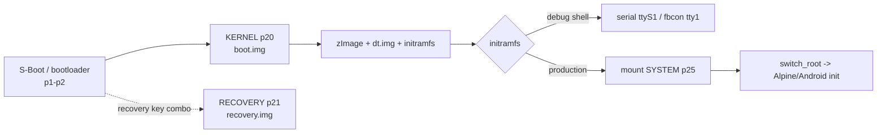

# Porting an OS to an old phone — a stage-gated method

**Worked example:** Samsung Galaxy J1 Mini 4G, `SM-J105F/DS` (`j1minilte`), Spreadtrum SC9830I.
**Audience:** one engineer with the phone, a Linux build host, and the will to read logs.
**Rule of the document:** a stage is done only when its *gate* produced an artifact or a log.
A compile is not a boot; a boot is not a working device.

This guide is the method. The two implementation tracks are still dossiers:
`docs/research/pmos-ecosystem.md` (Alpine/Nura userspace) and
`docs/research/source-landscape.md` §5.2 + `docs/research/porting-methodology.md` S8 (LineageOS
14.1). Device evidence and pins live in `docs/research/resource-inventory.md` and the other
dossiers under `docs/research/`.

---

## 0. Decide what "porting an OS" means

Three different products wear the same name. Pick one before touching a partition:

| Product | Boot chain | Userspace | Telephony | Typical effort |
|---|---|---|---|---|
| Custom recovery (TWRP) | stock kernel or your kernel + recovery ramdisk | recovery UI | no | days |
| Android ROM | your kernel + Android ramdisk | Android framework + vendor HALs | yes, via RIL blobs | weeks–months |
| Linux distribution | your kernel + Linux initramfs | Alpine/Nura/Debian | no (no SPRD modem driver) | weeks |

They share stages 1–5 and diverge at stage 6. Do not build the Android ROM first if the goal is a
pocket Linux computer, and do not promise calls on a Linux port of this SoC.

**Feasibility checklist** (answer with links/evidence, not optimism):

1. SoC support: is there a mainline kernel port, a vendor kernel tree, or only a binary?
   `SC9830I` has **no mainline support** and a vendor 3.10.65 tree; that forces a downstream port.
   A downstream port is a valid portfolio project but caps userspace at OpenRC-era Linux and fbdev.
2. Bootloader: unlockable? signature-enforcing? On 2016 Samsung S-Boot there is no unlock toggle;
   unsigned images load and only the warranty bit changes. Verify, do not assume.
3. Recovery: is a working custom recovery available or buildable? Without one, every experiment
   needs Odin and a PC.
4. Community artifacts: device trees, kernel forks, vendor blobs, a wiki page with feature statuses.
   Absence of artifacts is a cost multiplier; a DMCA'd blob repo is a single point of failure.
5. Parts: battery health, screen, touch, USB port. A port that cannot charge or enumerate is a brick
   with extra steps.
6. Display stack: `CONFIG_DRM`? If no, X11/fbdev only, no Wayland compositors (Phosh, Plasma, Lomiri,
   sway). This single fact eliminates most modern phone UIs.

Record the answers in `docs/research/os-options.md` style, with URLs and dates.

---

## 1. Capture device evidence before changing anything

You need ground truth that survives a wipe. Use ADB (stock) or TWRP (root shell).

```sh
adb shell getprop > getprop.txt
adb shell cat /proc/partitions > partitions.txt
adb shell ls -l /dev/block/platform/*/by-name > byname.txt
adb shell cat /proc/meminfo > meminfo.txt
adb shell cat /proc/cpuinfo > cpuinfo.txt
adb shell cat /proc/cmdline > cmdline.txt
adb shell dmesg > dmesg.txt
adb shell cat /proc/bus/input/devices > input_devices.txt
adb shell dumpsys battery > battery.txt   # or /sys/class/power_supply/*
adb shell df -h > df.txt
```

From these, extract and write down:

- exact model/codename/firmware (`ro.product.device`, `ro.build.PDA`, `ro.boot.bootloader`);
- partition names → block devices → **real sizes in bytes** (the by-name symlink target);
- boot geometry if you can unpack a stock boot image: page size, kernel/ramdisk/second/tags offsets;
- input devices and the touchscreen event node + axis ranges;
- battery/power sysfs paths;
- loaded kernel modules and firmware paths (Wi-Fi, GPU).

**Gate 1:** an evidence directory with real content (not error text), and a one-page device sheet.
For this project: `device/evidence/`, summarised in `docs/device/identity.md`.

**Trap:** numbers copied from a device tree are not evidence. This project's reference tree claimed
20 MiB boot/recovery partitions; the live partition table says **16 MiB**. Always take the smallest
verified value and fail closed above it.

---

## 2. Build the safety net

No flash happens before this stage is complete, verified, and duplicated off-device.

1. **Stock firmware** for the exact model/region. Note PDA, CSC, byte size, and whether any checksum
   is published. Account/paywall status matters: write it down so future-you does not hunt again.
2. **Raw partition backups** of everything that carries identity or calibration:
   `efs`, `prodnv`, modem/NV partitions if accessible. From a root shell:
   ```sh
   dd if=/dev/block/mmcblk0p17 of=/external_sd/backup/efs.img bs=4096
   dd if=/dev/block/mmcblk0p18 of=/external_sd/backup/prodnv.img bs=4096
   dd if=/dev/block/mmcblk0p21 of=/external_sd/backup/recovery_stock.img bs=4096
   dd if=/dev/block/mmcblk0p20 of=/external_sd/backup/boot_stock.img bs=4096
   ```
3. **Full recovery backup** (System/Data/EFS) to microSD, pulled to the PC.
4. **Checksums + restore commands** committed to git; images stay out of git.
5. **PIT/partition table** if the platform exposes one (`heimdall print-pit` on Samsung).
6. Rehearse the restore once, on paper, with the exact `dd` lines and the exact Odin slots.

**Gate 2:** four or more partition images with recorded SHA-256, a full backup verified on the PC,
and a restore procedure a stranger could follow. For this project: `device/evidence/stock-backup/`.

**Trap:** a TWRP "EFS backup" is not always a raw partition image. Take the raw `dd` copy.

---

## 3. Understand the boot chain before building one

Draw the chain for your device; every later failure localises to a link.



For a Samsung/Spreadtrum 2016 device, `boot.img` is Android header v0:

- page size 2048; kernel at `0x8000`, ramdisk at `0x01000000`, second at `0x00F00000`, tags at `0x100`;
- a Spreadtrum `dt.img` table (5 slots here, 329,728 B) appended after the ramdisk;
- optional `SEANDROIDENFORCE` tail;
- a hard partition-size ceiling (16 MiB here) — enforce it in the packer, not in a review comment.

**Gate 3:** you can parse a stock image with your own tool and reproduce its fields
(`tools/bootimg/parse_bootimg.py`). Byte-compare your packed `dt.img` against the stock DTBs; a
single-byte difference is a failed gate.

---

## 4. Recovery first

Recovery is the escape hatch and the test harness: it gives root, `dd`, `adb`, and a rollback path.

Minimum viable recovery port:

1. kernel that boots the board (vendor tree + correct defconfig + stock DTB set);
2. recovery ramdisk with a working `/etc/twrp.fstab` using **by-name** paths;
3. correct display geometry and input mapping (480×800, touch `event2`);
4. MTP/ADB enabled, brightness sane, reboot-to-download-mode available;
5. size-checked image, Odin tar and `dd` path;
6. one successful boot *after* a verified stock restore.

**Gate 4:** recovery boots, touch works, ADB root works, and a partition can be backed up and restored
from it.

**Trap:** recovery does not need the Android framework, so it is the cheapest way to validate kernel,
DTB, panel, touch, and storage. Build it before the ROM.

---

## 5. Kernel: choose the least-wrong base

Selection order, best first:

1. **Mainline** — not available for SC9830I. If your SoC has mainline support, use it; it buys DRM,
   modern GCC, and long-term maintainability.
2. **Vendor kernel that already boots the device** — here the committed 3.10.65 tree, whose DTBs and
   recovery image are proven.
3. **Sibling vendor kernel with the right SoC family** — here 3.10.100 `sharkls` (same SC9830 family,
   j1minilte DTS present) or 3.10.106 (3G sibling, wrong `CONFIG_MACH_*` for LTE).
4. **Random GitHub fork** — last resort; verify defconfig, DTS, and license before trusting it.

Build rules:

- cross-compile on Linux only; never from a Windows worktree (CRLF breaks Kconfig, reserved names
  break checkout);
- pin the toolchain (`arm-eabi-4.8` for this tree) and record its version;
- start from a defconfig that already matches the machine (`MACH_J1MINILTE`, `SCX35L`, `SIPC_LTE`);
- add one feature at a time: `CONFIG_ZRAM`, `CONFIG_USB_ETH`/RNDIS, framebuffer console;
- apply only patches that are needed now; the Nura SPRD patch set (gcc7/gcc8/gcc10, ARM-8933,
  piggy.gzip, sprdfb colors, sprdfb buffering) was verified to apply cleanly to this 3.10.65 tree;
- build `zImage`, then **rebuild `dt.img` from the stock DTBs** — do not trust kernel-built DTBs until
  they byte-match stock.

**Gate 5:** `zImage` builds reproducibly, `dt.img` is byte-identical to stock, the image fits 16 MiB,
and the boot header fields match the stock geometry.

---

## 6. Initramfs and userspace

The initramfs is a diagnostic instrument first and a boot loader second.

Stage it:

1. **Debug initramfs** — static busybox; mount proc/sys/dev; print `/proc/version`, `/proc/cmdline`,
   `/proc/partitions`, memory; drop a shell on serial and on fbcon. This is the H1 milestone in this
   project and the single most valuable artifact for remote debugging.
2. **Handoff initramfs** — mount the root filesystem read-only, fsck, mount read-write, move mounts,
   `switch_root`. Keep a fallback shell if any step fails.
3. **Production initramfs** — distro `mkinitfs` or your own; same fallback.

Userspace choices for a 1 GB ARMv7 phone:

| Choice | Graphics | Effort | Verdict |
|---|---|---|---|
| Nura (ex-postmarketOS) downstream | X11/fbdev; OpenRC | 4–7 pw | best upstream-shaped artifact |
| Alpine hand-built | X11/fbdev or console | 2–4 pw console, 8–14 pw polished | most control, best learning |
| Debian armhf / Arch ARM | X11/fbdev | 8–14 pw | heavy but conventional |
| Android 7.1 (LineageOS 14.1) | vendor hwcomposer/Mali | 6–10 pw | only route to calls/SMS |
| Halium family (Droidian/UT/Sailfish) | hybris | base ROM + 10–20 pw | rejected: requires a ROM that does not exist |

**Gate 6:** a shell on the device through a channel that survives reboots (serial or USB RNDIS/SSH).

---

## 7. Hardware bring-up order

Do not parallelise the first boot. One change, one boot, one log, one verdict.

| # | Subsystem | What proves it | Common failure |
|---|---|---|---|
| 1 | Console | `BOOT_EVIDENCE` line on serial or panel | wrong cmdline, fbcon off, panel not initialised |
| 2 | Display colours | red is red | `SPRD_IN_DATA_TYPE_ABGR888` default swaps R/B — patch to `BGR565` |
| 3 | Framebuffer API | Xorg starts, no `FBIOPUT_VSCREENINFO` error | `sprdfb_check_var` rejects multi-buffered `yres_virtual` — buffering patch |
| 4 | Touch | `evtest /dev/input/event2`, 0..479/0..799 | wrong event node, missing DTS node |
| 5 | Storage | mount SYSTEM/userdata, read/write | fstab by-name wrong, ext4 vs f2fs, partition size |
| 6 | USB networking | host sees `usb0`, SSH works | gadget function not configured, no `CONFIG_USB_ETH` |
| 7 | zram | `free -m` shows swap | `CONFIG_ZRAM` missing, no `swapon` service |
| 8 | Battery/charging | voltage/capacity/temperature sysfs | no power-supply driver binding |
| 9 | Wi-Fi | actual association + DHCP | firmware blobs (`sc2331_fw.bin`), `sprdwl` daemon, libhybris |
| 10 | Desktop | window manager on X, idle RAM measured | Wayland attempted on fbdev, too heavy for 1 GB |
| 11 | Poweroff/reboot | clean shutdown, no fs corruption | missing power driver, sync before halt |

**Gate 7:** display + touch + storage + network (the "developable remotely" state). **Gate 8:** the
same set stable across three consecutive cold boots.

---

## 8. Debugging without a UART

Ordered by cost:

1. **fbcon** — the kernel console on the panel. Enable `CONFIG_VT`, `CONFIG_FRAMEBUFFER_CONSOLE`,
   `console=tty0` in addition to serial. A panic scrolls on the screen.
2. **Serial** — `console=ttyS1,115200n8`; if the pads are accessible, this is the best channel.
3. **pstore/ramoops** — if the kernel has it, `/sys/fs/pstore` survives a reboot. Check the config.
4. **`last_kmsg`** — vendor kernels often expose `/proc/last_kmsg`; read it from recovery after a
   failed boot.
5. **USB RNDIS** — initramfs brings up `usb0` at a static address; `telnet`/SSH into a failed boot.
6. **Recovery ADB** — always available if recovery is intact; `dmesg` from recovery shows the last
   kernel, not the failed one.
7. **LED/vibrator** — a boot script can blink a code before anything else works.

Write the log to the SD card or serial before dropping to a shell. A boot without a log is not
evidence.

---

## 9. Release discipline

- Every published artifact: source commit, config, toolchain, build timestamp, SHA-256, size gate.
- Three consecutive boots per claimed milestone; one log per boot.
- A known-limitations page that states what was never tested (camera, modem, suspend, encryption).
- A rollback procedure that has actually been executed in both directions.
- Reproducible build script in-repo; CI is optional, determinism is not.

**Gate 9:** a stranger can reproduce the image and restore the phone from the docs alone.

---

## 10. Portfolio framing

What makes this a portfolio project rather than a flash:

1. **A reproducible pipeline** — pinned sources, scripts, checksums, CI artifacts.
2. **Evidence** — partition dumps, boot logs, before/after photos, failure analyses.
3. **A decision record** — why Linux, why Nura, why LineageOS second, what was rejected and why.
4. **Upstream-shaped artifacts** — an APKBUILD device package, kernel patches, a device tree, a
   `boot.img` packer, not just a zip.
5. **Honest limits** — "fbdev-only, no calls, no 3D, downstream kernel" is more credible than a
   feature list that cannot be demonstrated.

Publish: the repo, a short write-up per milestone, one hero photo of the device running the new OS,
and a "reproduce it" section that starts from a stock phone.

---

## Appendix A — J105F stage status (2026-10-23)

| Stage | Status | Artifact |
|---|---|---|
| 0 feasibility | done | `docs/research/os-options.md` |
| 1 evidence | done | `device/evidence/` |
| 2 safety net | done | `device/evidence/stock-backup/` (4 raw images + TWRP backup) |
| 3 boot chain | done | `out/local-verify.txt`, `tools/bootimg/parse_bootimg.py` |
| 4 recovery | built, **not flashed** | `recovery.img` `3651e105…` < 16 MiB |
| 5 kernel | built, **not flashed** | `boot.img` `e3125677…`, `dt.img` byte-identical |
| 6 userspace | not started | — |
| 7 bring-up | blocked on flash | — |
| 8 debug | debug initramfs built | serial + fbcon shell |
| 9 release | blocked | — |

Next physical action: flash TWRP via the proven `dd` path
(`docs/delivery/e1-flash-commands.md`), then the H1 kernel, then start stage 6.
No flash without an explicit human "yes" in the session.

## Appendix B — Tool map

| Need | Tool | Where |
|---|---|---|
| unpack/pack boot.img | `tools/bootimg/{parse,pack}_bootimg.py` | this repo |
| pack SPRD dt.img | `tools/bootimg/pack_dtimg.py` | this repo |
| kernel toolchain | `arm-eabi-4.8` @ android-5.1.1_r38 | CI script / local Linux host |
| Nura packages | `pmbootstrap` 3.12.1 + pmaports `c7940da7` | `reference/` |
| Android ROM | LineageOS `cm-14.1` manifest `3053abb` | `reference/` |
| flashing | TWRP `dd` (proven), Odin 3.13.1, Heimdall 2.2.2 | Windows host |
| rootfs | Alpine 3.24.3 armv7 minirootfs | `reference/alpine/` |
| blob/DTB truth | stock dump `aceed839` | `reference/j1minilte-dump/` |
